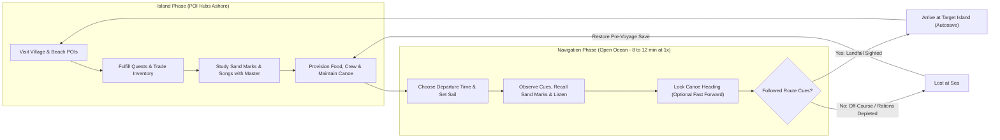
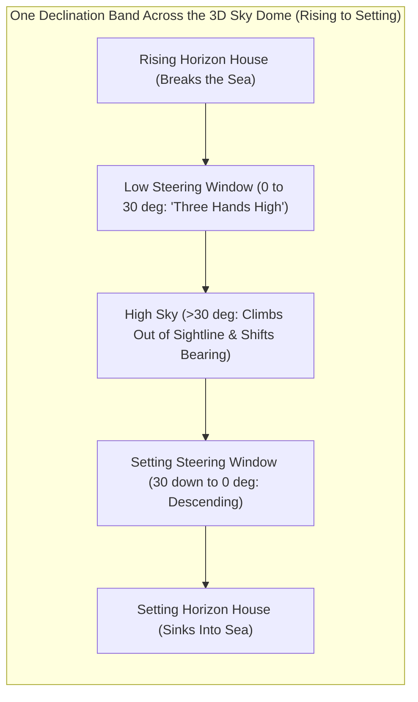
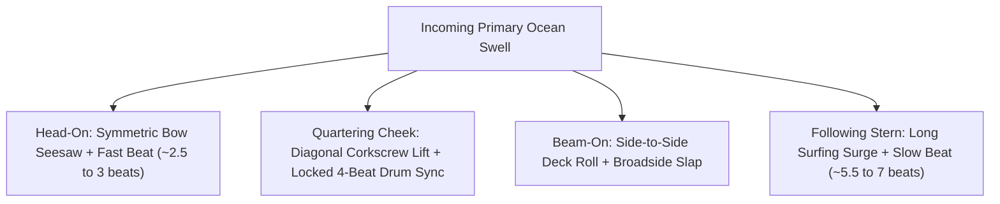
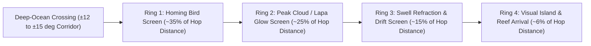
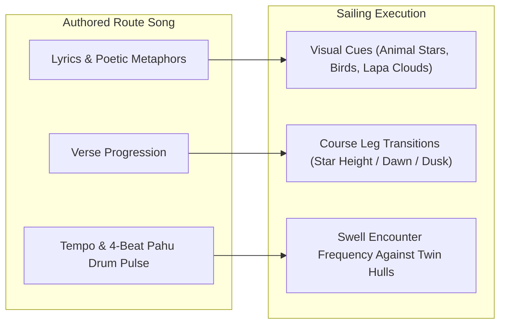
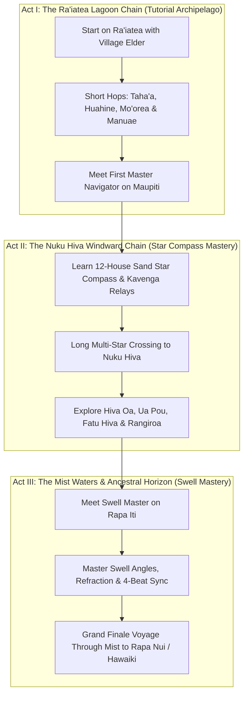
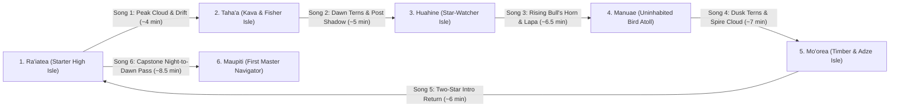
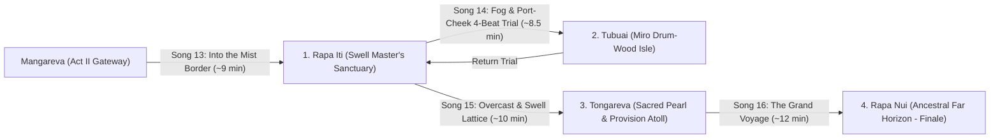

# Game Design Document: *Kavenga: Songs of the Star Path* *(Working Title)*

## 1. Executive Summary & High Concept

*Kavenga: Songs of the Star Path* is a contemplative, atmospheric 3D wayfinding adventure in which the player steps into the role of a traditional Polynesian navigator. Across two interlocking phases—learning, trading, and provisioning at **Point-of-Interest (POI) hubs** during the **Island Phase**, and sailing a double-hulled voyaging canoe across open water during the **Navigation Phase**—players cross a fictionalized Pacific Ocean inspired by authentic Polynesian history and place names, using zero maps, compasses, paper logs, or GPS.

Routes are preserved and taught orally through **baked-in navigation songs** paired with **stick-in-the-sand diagrams** drawn on the beach by master navigators. Song lyrics encode celestial and environmental landmarks while musical meter mirrors the physical rhythm of ocean swells. Rather than testing reflexes, racing clocks, or rapid clicking, the game rewards calm observation, listening, and genuine environmental literacy—guiding the player from feeling completely lost on an endless sea to reading the sky and water at a glance.

| Attribute | Target Specification |
| :--- | :--- |
| **Genre** | Contemplative Exploration / Musical Wayfinding Simulation / Adventure |
| **Camera Perspectives** | **Navigation:** 3D third-person behind & slightly above the double-hulled canoe + 360° Free-Look **Island:** Scenic Point-of-Interest (POI) coastal hubs + close-up **Teaching Sand** view |
| **Voyage Pacing** | **8–12 real-time minutes per voyage** at 1x speed (no abrupt time-skips); includes a heading-locked **Fast Forward** button that cuts voyage play time by **~60%** (~3–5 minutes) |
| **World Setting** | **Fictionalized ocean geography** (unspoilable by real maps) populated with **authentic Polynesian island names, terminology, and cultural traditions** |
| **Memory & Diegesis** | Oral songs + **marks drawn on wet sand with a stick** (revisitable via an at-sea **Recall** memory flash on *Easy*, *Medium*, and *Hard*; strictly **no paper journals or written logs**) |

---

## 2. Core Design Pillars

1. **From Mystery to Mastery:** Early on, the sky and sea feel vast and inscrutable. Every mechanic builds *player knowledge* rather than character stats, steadily transforming *"I have no idea where I am"* into *"I know my exact bearing from that cloud, those terns, and the Bull's Horn rising."*
2. **Music & Sand Are the Map:** In an oral culture without paper charts, navigation lives in voice, rhythm, and ephemeral marks sketched in beach sand. Songs and sand lessons directly encode star sequences, daytime wildlife cues, and swell frequencies.
3. **Unhurried Presence & Respect for Player Time:** Sailing is calm and deliberate—zero rapid clicking or twitch timing. At any moment, the player can lock steering trim to look freely around the horizon and sky, or engage **Fast Forward** to accelerate steady legs without skipping the visible movement of stars and waves.
4. **Accessible Authenticity:** Grounded in real Polynesian wayfinding (*kavenga* star paths, celestial rotation, *lapa* cloud reflections, homing seabirds, refracted swells, beach stick-drawings), distilled into readable game systems—such as simplified **Animal Constellations**—so astronomy enhances play rather than overwhelming it.

---

## 3. Core Gameplay Loop

The game alternates between focused preparation at coastal island hubs and open-ocean execution at sea.

> [!IMPORTANT]
> **Forgiving Failure State ("Lost at Sea"):** Straying irreversibly off course or exhausting provisions never punishes the player with tedious backtracking or permanent loss. When the canoe becomes lost in empty water, the screen gently fades into sea mist and offers an immediate **Restore Before Voyage** option—returning the player to the departure island before launch so they can re-watch the Master's sand drawings, re-listen to the chant, adjust provisions, or pick the proper departure hour.

---

## 4. Phase I: The Island Phase (Point-of-Interest Hubs)

Rather than free-roaming 3D walking levels, each island is presented as an atmospheric **Point-of-Interest (POI) Hub**—a curated set of scenic, painterly coastal locations navigated via clean node selection. This keeps production focused on rich environmental art, character encounters, and the 3D open-ocean sailing simulation.

### 4.1 Island POI Structure
Depending on whether an island is a major settlement or an uninhabited resource atoll, players visit 2–4 distinct POIs:
1. **The Canoe Landing (*Halau* / Beach):** Manage canoe maintenance, load food/water rations, assign crew, inspect cargo inventory, select departure time, and launch into the Navigation Phase.
2. **The Navigator's Shore (Teaching Sand):** Sit beside the local navigator or Grandmaster at the tide line to learn environmental lore, study **stick-in-sand diagrams**, and listen to **Route Songs**.
3. **The Village & *Marae* (Settlement):** Speak with island chiefs, artisans, and fishers; accept or complete inter-island delivery/retrieval quests; recruit specialist crew members.
4. **Wild Outpost Sites *(Uninhabited Isles)*:** Harvest rare regional items—such as sacred *tamanu* timber, basalt adze stone, pearl shells, or red *kura* feathers—needed to persuade distant Masters.

### 4.2 Stick-in-the-Sand Teaching (No Written Paper Logs)
True to Polynesian history—where wayfinding was passed down without paper or ink—there is **no written journal or notebook UI** anywhere in the game.
* **Interactive Sand Lessons:** When a Master teaches a navigation concept or breaks down a route song at the Navigator's Shore, the camera frames damp, smooth beach sand from overhead. Using a wooden stick (accented with coral pebbles, shells, and palm ribs), the Master draws clear visual diagrams while speaking or chanting:
  * *Star Compass Rings:* Twelve shells/pebbles placed around a central twin-canoe mark to illustrate rising and setting horizon houses and the star paths connecting them.
  * *Constellation Sketches:* Simple stick-drawn outlines of Animal Constellations pointing out exact target stars (*Bull's Horn*, *Rat's Nose*).
  * *Daytime & Swell Diagrams:* Stick grooves showing how deep swells bend around an island or how white terns radiate outward at dawn and return at dusk.
* **Rehearsal Ashore:** While on an island, the player can ask the Navigator to redraw any learned sand mark or re-chant any learned route song as many times as needed before setting sail.

### 4.3 Quests, Inventory & Persuasion
To earn a Master Navigator's trust and unlock coveted route songs, players undertake lightweight quests tied to a **Canoe Inventory**:
* **Examples:** Bringing volcanic obsidian adze blanks from **Hiva Oa** to a master canoe-builder on **Rangiroa**; retrieving ceremonial red feathers from the uninhabited cliffs of **Manuae**; or delivering medicinal *kava* root across the lagoon from **Tahaʻa** to **Huahine**.

### 4.4 Provisioning & Voyage Readiness
At the Canoe Landing POI, the player prepares their double-hulled canoe (*vaka moana* / *waʻa kaulua*):

| Readiness Factor | Gameplay Function | Trade-off / Strategic Choice |
| :--- | :--- | :--- |
| **Food & Water** | Consumed steadily over voyage time based on crew count; determines safe endurance before exhaustion triggers "Lost at Sea." | Rations share limited **Deck Cargo Slots** with quest items on smaller early-game canoes. |
| **Crew Members** | 2–4 companions (e.g., *Sail-Tender* to reduce wind drift, *Hull-Wright* to slow sea wear, *Fisher* to replenish food when passing tuna schools). | Extra crew add helpful passive traits on long crossings, but increase food/water burn. |
| **Canoe Maintenance** | Condition of **Twin Hulls**, **Pandanus Sail**, and **Sennit Lashings**. Repaired at the Canoe Landing using gathered/traded materials. | Neglected maintenance causes gradual heading drift or faster wear in rough squalls. |
| **Departure Window** | Player launches at **Dawn**, **Midday**, **Dusk**, or **Midnight**. | Crucial alignment with Verse 1 of the route song (e.g., a dusk bird-homing route requires departing before sunset). |

---

## 5. Phase II: The Navigation Phase

### 5.1 Camera, Controls & Continuous Time Flow ("Fast Forward")
* **Default Sailing Camera:** 3D view positioned behind and slightly above the double-hulled canoe:
  * **Bottom-Center (~20–25% of frame):** The twin hulls, central deck platform, crab-claw sail, wooden steering sweep, crew silhouettes, and wake—conveying wind trim and hull pitch/roll physically without UI gauges.
  * **Upper Frame (~75–80% of frame):** Expansive ocean surface, 360° horizon, cloud formations, wildlife, and sky dome.
* **Diegetic Trim-Lock Steering:** Adjusting the steering sweep sets a **tied-off paddle angle** holding the canoe's trim relative to wind and swell. Steering is 100% visual—aligning the twin prows, rigging, or stern directly against sky and sea cues with **zero HUD heading readout, degree number, or compass indicator**—requiring no constant clicking once aligned.
* **360° Free-Look Observation:** At any time, players can pan freely around the entire horizon (including **back-sighting** stars directly behind the stern), tilt straight up to the zenith, or inspect wave angles against the hulls, then snap smoothly back to steering.
* **Voyage Duration & The "Fast Forward" Button:**
  * **Standard Duration (1x Speed):** A full voyage takes **8–12 minutes** of real time (with brief ~4–6 minute introductory hops in early Act I), flowing continuously through day and night **without fade-to-black time-skipping**.
  * **Fast Forward Mode:** Pressing/toggling **Fast Forward** accelerates world time (~2.5x–3x speed) while **keeping the canoe locked on its current heading**. Stars visibly wheel faster across the sky dome, clouds build, and waves roll smoothly past.
  * **Time Savings:** Using Fast Forward during steady legs once aligned typically cuts total voyage playtime by **~60%** (bringing an 8–12 minute voyage down to **~3–5 minutes**), while keeping the player actively watching the sky and horizon for the next transition cue (such as a guide star climbing too high or dawn breaking) to drop back to 1x speed.
  * **Audio Handling in Fast Forward:** Rather than pitch-warping the sung chant, engaging Fast Forward smoothly crossfades vocals into rushing wind, wake, and a gentle rhythmic pulse, seamlessly restoring the song when returning to normal 1x speed.

---

### 5.2 Nighttime Navigation: The 3D Sky Dome & *Kavenga* (Star Paths)

#### 5.2.1 Celestial Sphere Geometry & Rotation
* **True Rotating Sky Sphere:** Surrounding the ocean is a seamless 3D celestial sphere rotating continuously from rising horizon to setting horizon (`15° per in-game hour`). Across a 12-hour night (~4–6 real-time minutes at 1x speed, or ~1.5–2 minutes in Fast Forward), the night sky rotates `180°` smoothly overhead.
* **Tropical Polynesian Tilt (`~10°S–15°S` Engine Reference Latitude):**
  * On one side of the sky (the southern polar pivot), the **Celestial Pole** sits low above the waves (`~12°–15°` altitude). Nearby stars (*The Sea Turtle* and *The Frigatebird*) wheel around this invisible pivot in tight circles—allowing the player to *deduce* that pole's direction purely by observing which stars spin in place or point toward the water.
  * Opposite that pivot (the northern horizon), the counter-axis dips just beneath the waves, causing *The Horse* to skim a low, shallow arc across the sea.
  * Between the two poles, all other stars travel along **parallel circular tracks (Declination Bands)**—breaking out of the sea at fixed horizon "houses" on the rising side, arcing overhead, and sinking into the mirror-image houses on the setting side.

#### 5.2.2 What a *Kavenga* Looks Like on the Sky Dome
A **Star Path (*Kavenga*)** is not a single star—it is a **relay chain of 3 to 4 named Animal Stars riding the exact same circular track across the sky dome**, spaced `~36°` apart in Right Ascension (`~2.4` in-game hours) along the nocturnal star-train so each successor star rises just as its predecessor climbs above the `30°` steering window (with each route anchored to a seasonal solar phase aligned to its recommended Departure Window):

1. **The "Three-Hands" Steering Window (`0°–30°` Altitude):**
   * From the default camera behind the canoe, the horizon sits roughly a quarter of the way up the screen and the upper edge of the frame reaches `~42°` sky altitude.
   * Any star between **the waterline and `~30°` elevation ("three hands high" above the sea)** appears **simultaneously in frame with the canoe's twin prows**, maintaining a steady horizon bearing. To steer, the player simply keeps that low star visually centered between the twin hulls (or aligned over a designated hull/spar).
2. **Why Stars Must Hand Off (Rising vs. Setting Paths):**
   * **Following Rising Stars:** The player aligns the twin prows on Star 1 (*e.g., Bull's Horn*) as it rises out of the sea. Over the next ~2–3 in-game hours, *Bull's Horn* climbs past "three hands high" (`>30°`): on tilted tracks it begins curving sideways in bearing, and visually it rises away from the prows toward the top of the frame. At that exact moment, **Star 2** on the same band (*Rat's Nose*) breaks the horizon in the **exact same Rising House right beneath it**. The navigator drops their gaze from the climbing star to the newly risen star and holds course seamlessly.
   * **Following Setting Stars:** When steering toward the setting side of the sky, stars run in reverse: the navigator tracks Star 1 as it *descends* toward the waves. Just before it sinks into the sea mist and vanishes, **Star 2** on the same track drops below three hands high directly above that same spot on the horizon, taking over the watch.
   * **Back-Sighting (Stern Stars):** Every Rising House lies directly opposite (`180°` across the water from) a Setting House. If storm clouds blot out the forward horizon, the player uses **360° Free-Look** to look straight back over the steering paddle and center the opposite house's star behind the stern.

#### 5.2.3 The 12-Shell Horizon Ring & 10 Animal Constellations
Traditionally called a "Star Compass" by scholars, this system is **not a physical or HUD compass**—it is a **mental and sand-drawn ring of 12 Horizon Cue Houses** formed by **5 parallel Rising/Setting Star Paths** plus the **2 Polar Pivots**, populated by **10 Animal Constellations**.

*(Note: Degree angles in the developer column below are **strictly internal 3D engine math** for placing stars on the sky sphere; players, songs, and sand lessons refer to directions exclusively by **Cue House Names**, never degrees or `N/E/S/W` labels.)*

| Star Path Band | Player-Facing Cue House Names *(Rising / Setting)* | 4-Star *Kavenga* Relay Sequence *(Spaced ~36° Apart Along Nocturnal Arc)* | Internal Engine Azimuths *(Hidden From Player)* |
| :--- | :--- | :--- | :--- |
| **Northern Pivot** | *House of the Grazing Horse* | *Horse's Crown* skims a shallow low arc across the water | `0°` |
| **Band 1** | *Rising / Setting Path of the Horse* | *Horse's Mane* -> *Horse's Tail* -> *Boar's Bristle* -> *Crab's Right Claw* | `30°` / `330°` |
| **Band 2** | *Rising / Setting Path of the Boar* | *Boar's Tusk* -> *Gecko's Tongue* -> *Crab's Left Claw* -> *Horse's Heart* | `60°` / `300°` |
| **Band 3** | *Rising / Setting Path of the Bull* *(Sun Path)* | *Bull's Horn* -> *Rat's Nose* -> *Shark's Jaw* -> *Crab's Eye* | `90°` / `270°` |
| **Band 4** | *Rising / Setting Path of the Shark* | *Bull's Hoof* -> *Rat's Tail* -> *Shark's Fin* -> *Gecko's Tail* | `120°` / `240°` |
| **Band 5** | *Rising / Setting Path of the Whale* | *Whale's Spout* -> *Whale's Fluke* -> *Shark's Tail* -> *Bird's Wingtip* | `150°` / `210°` |
| **Southern Pivot** | *House of the Sea Turtle's Pivot* | **The Sea Turtle** (*Shell Crown* tightly orbits pivot) + **The Frigatebird** (*Tail -> Beak* points down to pivot) | `180°` |

> [!TIP]
> **Cross-Band Constellation Geometry (How Master Navigators Read Raw Stars):** Large constellations intentionally span adjacent bands—for example, **The Bull** has its bright amber *Bull's Horn* on **Band 3** and its *Bull's Hoof* on **Band 4**, **The Shark** stretches diagonally across Bands 3, 4, and 5 (*Jaw -> Fin -> Tail*), and **The Gecko** bridges Band 2 (*Gecko's Tongue*) to Band 4 (*Gecko's Tail*) with **Gecko's Heart** (`-12°` declination) passing `90°` straight through the overhead zenith above the masthead. Even with zero UI lines in *Master Navigator* mode, spotting one familiar animal silhouette lets the player visually deduce neighboring star paths and distinguish rising vs. setting sides by watching which way the stars wheel!

#### 5.2.4 Visual Presentation on the Sky Dome (By Mode)
To keep the night ocean diegetic and ensure the player always deduces heading from the sky itself:
1. **Natural Starlight Layer *(Always Visible in All Modes)*:**
   * **Magnitude Hierarchy:** ~30 bright, unmistakable Primary Navigation Stars (with subtle natural warmth/coolness—amber *Bull's Horn*, icy blue-white *Shark's Fin*, golden *Shell Crown*) set against ~400 faint ambient stars that convey the sweeping rotation of the dome.
   * **The Milky Way (*Te Mangōroa*):** A soft, luminous celestial band arching near *The Shark* and *The Frigatebird*, offering natural macro-orientation at a glance.
   * **Horizon Extinction & Sea Shimmer:** Stars near the waterline softly pulse through horizon mist as they rise or set, naturally drawing the eye when a new relay star emerges.
2. **Constellation & Star Name Annotations *(Easy, Medium, Hard — Hidden in Master Navigator)*:**
   * **Animal Outlines & Names Only (Zero Horizon Compass Ticks):** Soft, chalky starlight strokes connect the stars of each Animal Constellation alongside clean star name labels (*"Bull's Horn"*, *"Rat's Nose"*). The horizon itself **never** displays `N/E/S/W` letters, degree ticks, or heading markers.
   * **Active Star Highlight *(Easy Mode Only)*:** In **Easy** mode, the target star named in the current verse (and its successor star rising/setting along the same path) softly shimmers in the sky—helping beginners spot the right star while still requiring them to look around the dome, find it, and steer the canoe to meet it.
3. **Static Sand-Ring Diagram *(Via "Recall" Button in Easy, Medium, Hard)*:**
   * Pressing **Recall** displays the static beach-sand diagram of the 12 shells and 5 parallel grooves taught ashore, reminding the player *which* animal stars share a path without ever indicating which direction the canoe is currently pointing.

---

### 5.3 Daytime & Ocean-Surface Navigation Cues

When sunrise washes out the stars—or when Act III clouds and sea fog hide the heavens altogether—the navigator relies on five interlocking daytime and ocean-surface systems, all readable directly from the 3D world and canoe deck with zero UI gauges.

#### 5.3.1 Solar Orientation & Crossbeam (*Iako*) Shadow Craft
1. **Dawn & Dusk Horizon Window (`0°–30°` Sun Altitude):**
   * The sun rises and sets along **Band 3 (*Path of the Bull*)**, casting a crisp golden glitter path across the waves toward the canoe. During the first and last ~2.5 in-game hours of daylight, the sun sits inside the forward camera frame and works just like a low horizon star.
2. **Mid-Morning & Afternoon (*Iako* Deck Shadows, `30°–75°` Altitude):**
   * Once the sun climbs out of the forward horizon sightline, squinting upward is imprecise. Instead, the **central mast-step / sighting post (*pou*)** casts a sharp, dark shadow across **symmetrical sennit-lashing bands** bound along the forward crossbeam (*iako*) and central deck platform (*pola*) at the bottom-center of the screen.
   * Before the morning sun climbs past three hands high, the player notes which lashing band the shadow touches while holding true course, then maintains that shadow alignment (accounting for its slow, predictable creep) through mid-morning and afternoon.
3. **Bridging the High-Noon Zenith (~1 In-Game Hour):**
   * Near solar noon, the post's shadow shrinks directly beneath its base and loses directional leverage. Navigators bridge this brief midday window by locking trim against **drifting trade-wind clouds** or **ocean swells** until the afternoon shadow lengthens cleanly on the opposite side of the deck.

#### 5.3.2 Cloud Craft (*Ao*) & Lagoon Reflection (*Lapa*)
The 3D sky shader distinguishes ordinary weather from island-born clouds through motion, silhouette, and underside color:
* **Drifting Trade Clouds (*Directional Grain*):** Flat-bottomed white cumulus arranged in parallel "cloud streets" marching steadily downwind. Tapping **Fast Forward** makes this sky-wide river of motion unmistakable, giving a reliable daytime reference axis.
* **Stationary Peak Clouds (*High Volcanic Islands*):** While surrounding trade clouds drift across the horizon, a single tall, dome- or anvil-topped cloud cap remains **pinned over one fixed spot** above an unseen mountain peak (such as *Moʻorea* or *Nuku Hiva*), anchored by a faint vertical mist-curtain beneath its base.
* **Lagoon Underside Glow (*Lapa — Low Coral Atolls*):** Open-ocean clouds have cool slate-grey or lavender undersides reflecting deep water. A cloud hovering over a shallow coral lagoon (like *Manuae* or *Rangiroa*) displays a luminous **pale turquoise-jade glow painted across its flat belly**, visible long before low palm trees break the horizon.

#### 5.3.3 Homing Seabirds & Surface Marine Trails
* **Land-Roosting Seabirds (*White Terns & Boobies*):** Unlike solitary open-ocean gliders, island-roosting terns and boobies fly in **purposeful, straight-line groups of 2–5 birds** at masthead height (`~5°–15°`), announced by crisp stereo calls left, right, or astern:
  * **Dawn / Early Morning:** Fly briskly *outward* from their roosting island to hunt -> **steer directly opposite their flight line** to reach land.
  * **Late Afternoon / Dusk:** Fly steadily *homeward* into the twilight -> **follow their tail feathers** straight to shore.
  * **Midday Nuance:** Wheel and dive in tight circles over baitfish -> signals a **surface fish school** (sailing through with a *Fisher* crew member aboard restores +1 food ration), *not* a directional line to land.
* **Leeward Surface Drift:** Downwind of an island, ocean wakes carry ribbons of golden reef-kelp, floating green coconut fronds, and pumice pebbles—confirming land lies directly upwind even in dense mist.

#### 5.3.4 Deep-Ocean Swells: Twin-Hull Physics, Stereo Audio & 4-Beat Coupling
To keep waves visually readable rather than chaotic, the 3D water surface separates **fine local wind ripples (chop)** from **Primary Deep Swells**—long, glassy, wide-spaced ocean ridges rolling endlessly along a constant axis (joined in Act III by shorter secondary **Cross-Swells**).

Because the twin hulls and crossbeams sit permanently at the bottom-center of the screen, the canoe itself behaves as a physical wave-reading instrument with **four unmistakable motion and stereo-audio signatures**:

| Canoe Angle to Incoming Swell | 3D Twin-Hull Visual Signature | Spatial Audio Signature | Encounter Rhythm *(vs. 4-Beat Song)* |
| :--- | :--- | :--- | :--- |
| **Head-On** *(Directly Into Swell)* | **Symmetric Pitch (Seesaw):** Both prows lift together toward the sky, throw twin bow spray, and dip together into the trough with zero roll. | Simultaneous twin-bow *whoosh-slap* centered equally in both ears. | **Too Fast (`~2.5–3 beats`):** Hulls charge into waves, cresting *ahead* of the *pahu* drum. |
| **Quartering "Cheek"** *(~45° Port or Starboard Bow — Standard Song Trim)* | **Diagonal Corkscrew ("Cheek Lift"):** For a *starboard-cheek* swell, the right prow lifts first, followed half a second later by the left prow as the crest rolls diagonally under the crossbeams. | Crisp **Right-to-Left** (or Left-to-Right) stereo cascade + warm lashing creak. | **Locked (`Exact 4 Beats`):** Leading prow crests in unison with **Beat 1** of the *pahu* gourd drum! |
| **Beam-On** *(Sideways to Swell)* | **Pure Side-to-Side Roll:** Deck tilts left-and-right like a metronome; mast tip sweeps sideways against sky/clouds; prows do not pitch. | Broad, flat *thump* against one outer hull wall. | **Wrong Motion:** Even near tempo, sideways rolling without bow lift reveals a perpendicular heading error. |
| **Following / Stern** *(Running With Swell)* | **Long Surfing Surge:** Stern lifts first, pressing twin prows slightly down as the canoe glides forward down the wave face. | Soft, hissing wake surge swelling from behind the camera forward. | **Too Slow (`~5.5–7 beats`):** Waves overtake the canoe slowly, lagging behind the 4-beat pulse. |

#### 5.3.5 Island Swell Refraction, Reflection & Wave Shadows
In Act III's overcast nights and daytime fog, unseen islands betray their presence by disrupting the Primary Swell—matching the **rock-and-groove sand diagram** taught by the Swell Master on *Rapa Iti*:
1. **Leeward Diamond Lattice (*Refraction*):** Swells bending around both flanks of an island cross in its lee, forming a visible **crisscross diamond wave pattern** on the water and imparting a distinctive *double-bob* shimmer to the twin hulls.
2. **Windward Pyramid Peaks (*Reflection*):** Faint counter-swells bouncing back off steep island cliffs collide with incoming swells to form sharp, white-tipped **pyramid crests** in open water.
3. **The Wave Shadow (*Calm Lee*):** Directly behind an island sheltering the sea, the deep rolling swell abruptly flattens—telling a practiced navigator that land lies immediately upswell through the fog.

### 5.4 Sailing HUD & UX: Strict "No Compass / No Absolute Heading" Rule

> [!WARNING]
> **Inviolable UX Rule — Zero Absolute Heading Indicators:** Across **all** difficulty levels (including *Easy*), the sailing HUD must **never** include a compass rose, rotating heading tape, cardinal letters (`N / S / E / W`), degree numbers, minimap, or "current heading" arrow. Deducing orientation exclusively from stars, sun, shadows, clouds, birds, and swells is the foundational gameplay of *Kavenga*.

* **On-Screen Controls Only:** Subtle, non-directional corner icons for **Free-Look**, **Fast Forward**, and—on *Easy*, *Medium*, and *Hard*—the **Recall** button (plus on-screen song lyrics/cue translations in *Easy* and *Medium*).
* **Static Nature of "Recall":** Pressing **Recall** opens a fixed, sand-textured memory vignette showing the **exact static stick-marks on beach sand** as drawn by the Master ashore. It **never** rotates dynamically with the canoe or camera, never highlights where the player is currently facing, and never points toward the destination—the player must always cross-reference that mental sand diagram against the live 3D sky and sea.

---

### 5.5 Course-Tolerance, Drift & "Lost at Sea" Mechanics

Without a compass or GPS, requiring pinpoint `±1°` accuracy across an 8–12 minute crossing would feel punishing and artificial. Instead, *Kavenga* models the authentic Polynesian concept of **Expanded Target Screens**—where long-range star or swell navigation brings the canoe into a wide outer detection zone, and local island cues guide the final approach onto the beach.

#### 5.5.1 Continuous Ocean Plane & Concentric Island Screens
Under the hood, each ocean region is simulated on a continuous, wall-less 2D `(X, Z)` coordinate plane (wandering into a neighboring island's screen in a dense archipelago genuinely lets you discover and land on that island!). Every island is surrounded by **four concentric, diegetic detection rings**:

| Detection Ring | Radius *(Relative to Standard Hop)* | Cues Triggered Inside Ring | Gameplay Purpose |
| :--- | :--- | :--- | :--- |
| **Ring 1: Biological Screen** | `~35%` of route length | Radial dawn/dusk **white terns & boobies** cross near the canoe. | Widest safety net: rewards holding within `±15°` (half a Star House) across open water. |
| **Ring 2: Cloud Screen** | `~25%` of route length | **Stationary Peak Cloud** (high island) or **pale green *Lapa* cloud belly** (coral atoll) becomes visible on the horizon. | Visual beacon confirming the island's exact bearing well before land rises above the sea curve. |
| **Ring 3: Swell & Drift Screen** | `~15%` of route length | **Diamond swell refraction**, **cliff reflections**, **wave shadow**, and **leeward kelp/frond trails** appear. | Crucial in Act III sea fog or moonless overcast when neither birds nor clouds can be seen. |
| **Ring 4: Landfall Trigger** | `~6%` of route length | 3D island silhouette rises clearly; reef surf sounds; triggers **Arrival Sequence** & autosave. | Graceful completion transition into the target island's POI Hub. |

#### 5.5.2 Heading Tolerance & Transition Grace Windows
* **Generous Deep-Water Capture Cone (`±12° to ±15°`):** Because the 12 Horizon Cue Houses sit `30°` apart (`±15°` half-width), keeping a target star roughly framed near the twin prows—or keeping hull motion roughly in sync with the 4-beat swell—reliably delivers the canoe into **Ring 1 & Ring 2**, where local cues naturally funnel the player home.
* **Unhurried Star-Handoff & Leg-Pivot Grace (`~45–90s` at 1x Speed):** As a star climbs above three hands high (`>30°`), its horizontal bearing shifts gradually (`~3°–6°` per in-game hour), never snapping abruptly. Taking a full minute in Free-Look to study the sky, press **Recall**, or listen to a verse change costs virtually zero corridor margin.
* **Fast-Forward Safety Behavior:** Because Fast Forward runs at a controlled `~2.5x–3x` speed (not an instant warp), players always have `15–30` real-time seconds to spot a climbing star or twilight shift. When song audio is active (*Easy*, *Medium*, *Hard*), starting a **new song verse** automatically eases Fast Forward back to `1x` speed so the player never misses a leg transition (optional setting for veterans).

#### 5.5.3 Wind Leeway & Canoe Condition Drift
To keep Trim-Lock meditative while making island preparation meaningful, drift follows clear diegetic rules:
* **Well-Maintained Canoe (`>= 70%` Condition):** Once Trim-Lock is set, unintended steering creep is **`0°/min`**—the paddle holds steady relative to the water.
* **Crosswind Leeway *(Sideways Slip)*:** Strong beam winds push the canoe `~3°–5°` sideways downwind even while the prows face a star. Players can spot leeway diegetically by looking astern in Free-Look: in a crosswind, the **foamy wake trail angles slightly off-center** behind the twin sterns (halved by bringing a *Sail-Tender* crew member, or compensated by aiming half a prow upwind of the target star).
* **Neglected Maintenance (`< 50%` Lashings / Sail / Hulls) or Squalls:** Frayed sails and loose sennit cordage introduce a slow, audible weathercocking creep (`~2°–3° per real-time minute`) accompanied by louder lashing creaks and fluttering sail edges—encouraging hull repairs ashore before multi-leg crossings without ever demanding rapid clicking.

#### 5.5.4 Exact "Lost at Sea" Triggers & Cue-Relative Debrief
A voyage ends in **Lost at Sea** under two transparent conditions—never invisible corridor walls:
1. **Ration Exhaustion (`Food & Water == 0`):**
   * Woven food baskets and water gourds stacked visibly on the canoe's central deck (*pola*) dwindle over the voyage.
   * *Early Diegetic Warning (`~15%` remaining):* Deck baskets sit nearly bare, crew posture droops, and ocean wind shifts to a sparse nose-flute motif—giving a player already inside Ring 1 or Ring 2 enough buffer to complete landfall.
   * *Depletion (`0%`):* Sea mist gently envelops the canoe and presents **Restore Before Voyage**.
2. **Empty-Ocean Divergence *(Time-Saving Mercy Rule)*:**
   * If a player sails `180°` away from an archipelago with full rations, forcing them to wait 10 minutes for food to run out would waste their time. If the canoe exceeds `125%` of the route's expected distance (or exits the archipelago basin) with **zero islands inside a wide `±60°` forward arc** and **no active Detection Rings (`Ring 1–4`)**, open-ocean mist rolls in early to trigger **Restore Before Voyage**. Players may also manually select *Retire Watch & Restore* from the pause menu at any time.
3. **Cue-Relative Post-Mist Reflection *(Easy & Medium Only)*:**
   * Before restoring to the departure beach, *Easy* and *Medium* modes offer a single-sentence navigator's reflection phrased **strictly in cue-relative language** (never cardinal directions or degrees)—for example: *"You held the sinking sun true in Verse 1, but when the Bull's Horn climbed past three hands high, your twin prows wandered from the Rising Rat's Nose."*

---

## 6. Music & Navigation Coupling System

Every discoverable route has an authored, **baked-in vocal and percussive chant** whose words, structure, and tempo serve directly as navigational instruments.

### 6.1 Dual-Layer Musical Encoding

1. **Lyrical Imagery -> Concrete Cues:** Poetic phrases map consistently to lessons drawn in the sand ashore (e.g., *"follow the white fisher home to sleep"* = steer with dusk-homing terns; *"set the Bull's Horn between the twin prows"* = center the rising *Bull's Horn* star between the two hulls).
2. **Verse Structure -> Route Legs:** Each verse corresponds to a sequential leg of the 8–12 minute voyage, telling the navigator *when* to pivot headings or hand off along a *kavenga* as stars climb past three hands high.
3. **Musical Rhythm -> Ocean Swell Cadence:**
   * In swell-guided waters, the beat of the song physically matches the wave encounter period **when the canoe is held on the correct heading**.
   * **Example:** In a chant driven by a deep *pahu* drum accent every **4 beats**, primary swells lift the canoe's bow in exact **4-beat synchronization** with the drum *only* at the true heading angle.
   * Turning too far **into** the swell makes waves strike faster (every ~2.5–3 beats, rushing ahead of the music); turning too far **away** delays wave crests (every ~5.5–6 beats) or shifts motion into a sideways roll. Steering becomes the meditative act of tuning the hull's rise-and-fall to match the song's heartbeat.

### 6.2 Worked Example: Late-Game Full-Mastery Route Song (Act III Showcase)
*Route: "The Chant of Tongareva" (Dusk-to-Morning Crossing from Rapa Iti to Tongareva Atoll)*

> **Verse 1 (Dusk Departure):** *"Put Rapa Iti's Fortress Crag behind your stern-post / Sail against the sinking sun until the Crab's Left Claw breaks the dark foam."*
> **Verse 2 (Night *Kavenga* — Path of the Bull):** *"Turn your twin prows to the Rising Bull's Horn / When he climbs three hands above the sea, let the Rat's Nose carry your wake."*
> **Verse 3 (Dawn Swell & Landfall):** *"Take the deep swell every four beats upon your starboard cheek / Watch for the pale green lagoon painting the morning cloud's belly."*

### 6.3 The Four Difficulty & Mastery Modes

Notice the clean progression across the four tiers: *Easy -> Medium -> Hard* gradually removes **on-screen song decoding** while retaining visual constellation labels and static Sand Recall, whereas *Master Navigator* removes **all external aids** at sea:

| Mode | Audio Song at Sea | On-Screen Song Text *(Cue-Relative Only)* | "Recall" Button *(Static Sand Marks)* | Sky & Star Annotations *(No Compass/Horizon Ticks)* | Target Experience |
| :--- | :--- | :--- | :--- | :--- | :--- |
| **EASY** *(Apprentice)* | **Plays at sea** | **Lyrics + Cue-Based Instructions** *(e.g., "Center twin prows on Rising Bull's Horn; at 3 hands high, follow Rising Rat's Nose")* | **Enabled at sea** | **Annotated** *(constellation lines, star names + active star shimmer)* | Relaxed, guided onboarding connecting music, sand lessons, and sky cues without ever giving away a compass bearing. |
| **MEDIUM** *(Wayfinder)* | **Plays at sea** | **Lyrics Only** *(no explicit instructions)* | **Enabled at sea** | **Annotated** *(constellation lines + star names)* | Core interpretive puzzle mode: combine on-screen lyrics + recalled sand diagrams to deduce heading. |
| **HARD** *(Navigator)* | **Plays at sea** | **None** *(no text on screen)* | **Enabled at sea** | **Annotated** *(constellation lines + star names)* | Pure auditory comprehension: listen closely to sung words and drum cadence, cross-referencing Sand Recall as needed. |
| **MASTER NAVIGATOR** *(Grandmaster)* | **Silence at sea** *(natural ocean audio only; memorize song ashore)* | **None** | **Disabled at sea** *(pure memory)* | **Unannotated** *(raw starfield only)* | True traditional mastery: sing the chant and count its swell rhythm internally while reading naked-eye star shapes. |

> [!NOTE]
> Regardless of difficulty, **all songs and stick-in-sand diagrams remain freely accessible ashore** at the Navigator's Shore POI before every voyage, ensuring *Master Navigator* rewards attentive study and real wayfinding mastery rather than guesswork.

---

## 7. Fictionalized Polynesian World & Three-Act Progression

The ocean layout is **fictionalized**—designed specifically around the 12-House Star Compass, 8–12 minute voyage legs, and unspoiled exploration—while honoring Polynesian heritage by using **real island names, geographical archetypes, and voyaging traditions**.

### Act I: The Raʻiātea Chain *(Near-Shore Basics & Tutorial)*
* **Setting:** Begins on **Raʻiātea**, surrounded by a sheltered fictionalized cluster of nearby high islands and coral atolls (**Tahaʻa**, **Huahine**, **Moʻorea**, uninhabited bird-atoll **Manuae**, and outer windward **Maupiti**).
* **Guidance & Cues:** A kindly village navigator draws foundational stick marks in Raʻiātea's lagoon sand—teaching stationary clouds, *lapa* coral reflections, dawn/dusk seabird vectors, surface fish trails, and introductory single-star beacons from *The Bull* and *The Rat* (short dusk/evening hops where a single star gets the player close enough to spot reef cues before climbing past three hands high).
* **Pacing & Quests:** Forgiving single-leg chants; gathering timber and pearl lures across neighboring islands to repair the canoe and earn the trust of the **First Master Navigator** on Maupiti.

### Act II: The Nuku Hiva Chain *(The Star Compass & Deep Ocean)*
* **Breakthrough Sand Lesson:** On Maupiti's shore, the First Master draws the complete **12-Shell Sand Star Compass**, teaching full-night sky rotation, multi-star *kavenga* relay handoffs across all 5 Declination Bands and 10 Animal Constellations, rising vs. setting star logic, and stern back-sighting.
* **The Deep Crossing:** Armed with a multi-verse crossing chant and expanded rations, the player sails out of sight of all land—watching islands vanish behind the wake and handing off across 3–4 sequential animal stars through a full night—to reach the rugged **Nuku Hiva Windward Chain** (**Nuku Hiva**, **Hiva Oa**, **Ua Pou**, **Fatu Hiva**, **Mangareva**, and vast coral ring **Rangiroa**).
* **Regional Mastery:** Exploring every island in the second chain involves multi-leg routes turning from one Star Path house to another mid-voyage, departure-window planning, specialist crew management, and inter-island trade quests.

### Act III: The Far Mist Isles *(Ocean Swells & Grand Finale)*
* **Breakthrough Sand Lesson:** After charting the entire second chain, the player meets the reclusive **Swell Master Navigator** on **Rapa Iti**. With curved grooves in wet sand and rhythmic strikes on a gourd drum, they teach primary vs. cross-swells, island swell refraction diamonds, and **drum-beat-to-swell synchronization**.
* **Misty & Overcast Routes:** Voyages past remote outposts (**Tubuai**, **Tongareva**) feature cloud-banked nights (where only patchy glimpses of high stars or stern stars peek through) and daytime sea fog—requiring the player to hold course by hull motion and musical rhythm.
* **The Grand Voyage:** A culminating expedition to the legendary far-horizon island of **Rapa Nui** (or mythical **Hawaiki**), uniting daytime wildlife, rotating *kavenga* star relays, resource preparation, and rhythmic swell-feeling into one unforgettable master chant.

---

## 8. Audiovisual Direction & Atmosphere

* **Visual Identity:** Warm, painterly 3D prioritizing legible natural phenomena—crisp horizon silhouettes, rich twilight color shifts, distinct constellation geometry, tactile sand grains and wet stick grooves during shore lessons, translucent ocean swells, and bioluminescent wake sparkles at night.
* **Spatial & Musical Soundscape:**
  * **Diegetic Cues:** Subtle stereo positioning of wind in the sail, birds calling off port/starboard beams, and wave slap against the twin hulls so players can literally *hear* canoe alignment.
  * **Baked-In Chants:** Traditional-inspired vocal harmonies, nose flute (*vivo*), and *pahu* gourd percussion mixed naturally over ocean ambiance so drum downbeats lock cleanly with visual hull pitch.

---

## 9. Appendix A: Complete Act I Blueprint (*The Raʻiātea Chain*)

Act I serves as a self-contained, 6-island opening archipelago designed to onboard the player gently—introducing **one new navigational concept per voyage**, weaving a cohesive inter-island trade and canoe-restoration loop, and culminating in an audience with the **First Master Navigator** on outer windward **Maupiti** (strictly reserving full 12-Shell Star Compass mastery for Act II and ocean swell reading for Act III).

### 9.1 Archipelago Topology & Progression Flow

* **Looping Progression & Return Chants:** The core quest chain forms a natural 5-island circuit returning to **Raʻiātea** to consecrate the fully restored canoe before tackling the windward passage to **Maupiti**. Whenever the player discovers an inhabited island, its local navigator also shares simple **return verses** along reversed daytime/star cues so the player can revisit any discovered island to restock rations or swap crew.

---

### 9.2 The 6 Act I Islands: POIs, Sand Lessons & Quest Economy

*(Starting Canoe State on Raʻiātea: Coastal double-hulled canoe with **4 Deck Cargo Slots**, 1 loyal starter paddler, Hulls `75%`, Sail `75%`, Lashings `65%`.)*

| Island & Archetype | Active POIs | Mentor & Stick-in-Sand Lessons Taught | Quest / Cargo Role & Upgrades |
| :--- | :--- | :--- | :--- |
| **1. Raʻiātea** *(Sacred High Island — Home)* | • Canoe Landing • Navigator's Shore • Village & *Marae Taputapuātea* | **Elder Metua** *(Village Navigator)*: 1. *Stationary Peak Cloud vs. Drifting Trade Clouds* 2. *Leeward Frond & Kelp Trails* *(Later, before Song 6)*: *Checking Foamy Wake Leeway Astern* | **Main Act I Goal:** Bring **Red *Kura* Feathers** + restore Canoe to `100%` so Elder Metua consecrates the vessel and teaches **Song 6 (Maupiti)**. |
| **2. Tahaʻa** *(Sheltered Lagoon Isle)* | • Canoe Landing • Navigator's Shore • Hillside Village | **Hina** *(Fisher-Navigator)*: 1. *Dawn Outward vs. Dusk Homeward White Terns* (+ midday baitfish-circle warning) 2. *Sunrise & Forward Crossbeam (Iako) Post Shadow* | • Gives **Pandanus Sennit Cordage** *(repairs Lashings to `100%`)* • Provides **Medicinal *Kava* Bundle** *(wanted on Huahine)* • Recruits **Tama (*Fisher* Crewmate)** |
| **3. Huahine** *(Twin-Peak Artisans' Isle)* | • Canoe Landing • Navigator's Shore • Twin-Bay Village | **Ariʻi** *(Night-Sky Elder)*: 1. *Pale Jade Lagoon Glow (Lapa)* on atoll cloud bellies 2. *Sand Sketches of **The Bull** (Bull's Horn) & **The Rat** (Rat's Nose)* in the 3-Hands Window | • Trade **Medicinal *Kava* Bundle** -> Ariʻi teaches **Song 3 (Manuae)** & **Song 4 (Moʻorea)** • Crafts **Woven Pandanus Sail** *(repairs Sail to `100%`)* |
| **4. Manuae** *(Uninhabited Coral Atoll)* | • Lagoon Beach • Wild Rookery & Pearl Shallows *(Outpost)* | *Uninhabited — quiet environmental storytelling reward for trusting night stars & lapa glow.* | • Harvest **Ceremonial Red *Kura* Feathers** *(for Raʻiātea's Marae)* • Harvest **Giant Pearl-Shell Lures** *(prized on Moʻorea)* |
| **5. Moʻorea** *(Jagged Volcanic Spire)* | • Canoe Yard Beach • Navigator's Shore • Spire-Foot *Marae* | **Vaihere** *(Canoe-Wright Navigator)*: 1. *Following Setting Stars Downward* 2. *Two-Star Handoff Preview (Bull's Horn -> Rat's Nose)* | • Trade **Pearl-Shell Lures** -> repairs **Twin Hulls to `100%`**, expands Deck Cargo **`4 -> 6 Slots`**, gives **Polished Basalt Adze** *(gift for Maupiti's Master)*, and teaches **Song 5** |
| **6. Maupiti** *(Outer Windward Fortress)* | • Reef-Pass Beach • **Master Teraʻi's Teaching Sand** • Cliff Sanctuary | **First Master Teraʻi**: • Draws the **Complete 12-Shell Horizon Ring** across all 5 Star-Path Bands & 10 Animal Constellations! | • Present **Polished Basalt Adze** after discovering all 6 Act I islands -> unlocks **Act II's Deep Crossing Chant to Nuku Hiva**! |

---

### 9.3 Complete Act I Route Songs & Cue-Relative Decoding

Every Act I chant uses **strictly cue-relative imagery** (zero cardinal words or compass degrees), scaling gradually from a single daytime cloud to an overnight multi-cue passage:

#### Song 1: *"The Still Cloud of Tahaʻa"* (`Raʻiātea -> Tahaʻa`)
* **Recommended Departure:** **Dawn** | **1x Duration:** `~4 min` *(~1.5–2 min with Fast Forward)*
* **Mechanics Taught:** Trim-Lock steering, 360° Free-Look, Fast Forward motion contrast, Stationary Peak Clouds, Leeward Drift.
> **Verse 1:** *"Leave Raʻiātea's bay with the rising sun warm upon your right cheek / Watch the white wind-clouds march while one tall cloud stands still / Follow the green palm-fronds floating down from Tahaʻa's shore."*
* ***Easy*-Mode Cue Text:** *"Look right in Free-Look to place the rising sun off your starboard beam; center your twin prows on the single motionless tall cloud on the horizon, then steer along the floating green fronds."*

#### Song 2: *"Beaks of the Morning Fisher"* (`Tahaʻa -> Huahine`)
* **Recommended Departure:** **Dawn** | **1x Duration:** `~5 min`
* **Mechanics Taught:** Dawn outward seabird vectors, midday bonito fish-school foraging (with *Tama*), *Iako* post-shadow tracking.
> **Verse 1 (Dawn):** *"Launch into the pale dawn where the white terns fly out to hunt / Point your twin prows straight into their beaks against their morning flight."*
> **Verse 2 (Mid-Morning):** *"When the sun climbs above your sail, keep the post's dark shadow upon the second left lashing / Pass through the silver leaping fish until twin peaks break the sea."*
* ***Easy*-Mode Cue Text:** *"Verse 1: Spot straight-flying white terns at dawn and steer directly opposite their flight path. Verse 2: Hold heading by keeping the deck post shadow on the second port crossbeam notch past the leaping fish."*

#### Song 3: *"The Jade Belly of Manuae"* (`Huahine -> Manuae Atoll`)
* **Recommended Departure:** **Dusk** | **1x Duration:** `~6.5 min`
* **Mechanics Taught:** Stern island back-sighting + dusk solar alignment, first nighttime Animal Star (*Setting Bull's Horn*), coral atoll *Lapa* cloud reflection.
> **Verse 1 (Dusk):** *"Set Huahine's twin peaks straight behind your steering sweep and chase the sinking sun across the golden foam."*
> **Verse 2 (Night into Dawn):** *"Center the amber Setting Bull's Horn descending between your prows / When grey dawn softens the sky, steer beneath the flat cloud painted green on its belly."*
* ***Easy*-Mode Cue Text:** *"Verse 1: Steer toward the setting sun (check Free-Look astern to keep Huahine's twin peaks centered behind your stern). Verse 2: At night, center the Setting Bull's Horn between your twin prows; at dawn, steer toward the low cloud glowing pale turquoise underneath."*

#### Song 4: *"Homeward Wings to Moʻorea"* (`Manuae Atoll -> Moʻorea`)
* **Recommended Departure:** **Midday** *(arriving near Dusk)* | **1x Duration:** `~7 min`
* **Mechanics Taught:** Bridging afternoon sun-shadow into dusk homing birds and stationary volcanic spire cloud.
> **Verse 1 (Afternoon):** *"Put the green ring of Manuae behind your wake / Hold the afternoon post shadow steady across the left outer lashing while trade clouds march across your bow."*
> **Verse 2 (Dusk):** *"When the sun sinks golden off your right beam, follow the white tern's tail feathers homeward / Aim where the jagged spire-cloud stands unmoving against the twilight sea."*
* ***Easy*-Mode Cue Text:** *"Verse 1: Keep the deck post shadow aligned with the outer port (left) lashing as afternoon sun shines from starboard. Verse 2: Near sunset, follow straight-flying white terns in the same direction they fly toward the motionless tall spire cloud."*

#### Song 5: *"Return to Taputapuātea"* (`Moʻorea -> Raʻiātea`)
* **Recommended Departure:** **Dusk** | **1x Duration:** `~6 min`
* **Mechanics Taught:** First gentle **2-star rising handoff** (*Bull's Horn -> Rat's Nose*) along a single band before meeting the Master.
> **Verse 1 (Early Night):** *"Leave Moʻorea's spire astern as darkness falls / Place the Rising Bull's Horn squarely between your twin prows."*
> **Verse 2 (Late Night to Dawn):** *"When the Bull's Horn climbs three hands above the dark sea, drop your eyes to the Rising Rat's Nose / Hold him true until sacred Raʻiātea lifts against the morning light."*
* ***Easy*-Mode Cue Text:** *"Verse 1: Center the Rising Bull's Horn between your twin prows. Verse 2: Once Bull's Horn climbs high near the top of your view, switch to the Rising Rat's Nose right beneath it on the horizon."*

#### Song 6: *"The Outer Pass of Maupiti"* (`Raʻiātea -> Maupiti` — Act I Capstone)
* **Recommended Departure:** **Midnight** *(sailing into Dawn)* | **1x Duration:** `~8.5 min`
* **Mechanics Taught:** Setting-side 2-star handoff (*Setting Bull's Hoof -> Setting Rat's Tail*), crosswind wake-leeway compensation, and dawn booby landfall funnel.
> **Verse 1 (Midnight):** *"Steer for the Setting Bull's Hoof descending toward the dark foam / Glance back at your white wake—lean half a prow into the wind so your trail runs straight."*
> **Verse 2 (Pre-Dawn):** *"Before the Bull's Hoof drowns beneath the sea, let the Setting Rat's Tail take the watch above him."*
> **Verse 3 (Dawn Landfall):** *"At first light, steer against the brown boobies flying outward / Thread the foaming reef-pass where Maupiti's fortress rock stands."*
* ***Easy*-Mode Cue Text:** *"Verse 1: Aim toward the Setting Bull's Hoof (aim half a prow into the crosswind so your stern wake trails straight). Verse 2: Just before Bull's Hoof sets into the water, track the Setting Rat's Tail descending above it. Verse 3: At dawn, steer opposite outward-flying boobies to reach Maupiti."*

---

## 10. Appendix B: Complete Act II Blueprint (*The Nuku Hiva Windward Chain*)

Upon presenting the **Polished Basalt Adze** on Maupiti, **First Master Teraʻi** draws the **Complete 12-Shell Horizon Ring** in the wet sand—unlocking all 5 Star-Path Bands and 10 Animal Constellations. Act II challenges the player to cross empty blue water out of sight of all land, execute 3-star *kavenga* relays, steer by polar pivots and stern back-sighting, read overhead zenith stars, and chart every island in the 6-island **Nuku Hiva Windward Chain** (still strictly prior to learning ocean swells in Act III).

### 10.1 Act II Topology & Progression Flow

---

### 10.2 The 6 Act II Islands: POIs, Sand Lessons, Crew & Canoe Upgrades

| Island & Archetype | Active POIs | Mentor & Stick-in-Sand Lessons Taught | Quest / Cargo Role & Upgrades |
| :--- | :--- | :--- | :--- |
| **1. Nuku Hiva** *(Towering Valley Hub)* | • Taiohae Canoe Beach • Navigator's Shore • Chief's *Marae* | **Master Teiki**: 1. *Polar Pivots in the Sand (Grazing Horse vs. Sea Turtle's Pivot)* 2. *Planning Multi-Day Rations vs. Crew Burn* | • Regional hub; Elders promise the guarded southern route out of the chain once all 6 regional islands are charted and united. |
| **2. Ua Pou** *(Basalt Spire Isle)* | • Pebble Cove • Navigator's Shore • Carvers' Terrace | **Vaea** *(Wind-Watcher)*: • *Reading Band 1 (Path of the Horse) & Compensating Strong Trade Winds* | • Recruits **Moana (*Sail-Tender* Crewmate — halves crosswind leeway)** • Crafts **Carved Bone Harpoon Heads** *(wanted on Rangiroa)*. |
| **3. Rangiroa** *(Immense Coral Atoll)* | • Lagoon Pass Beach • Navigator's Shore • Pearl Divers' Village | **Tane** *(Atoll Navigator)*: • *360° Stern Back-Sighting Along Opposite Houses When Forward Rain-Clouds Bank Low* | • Trade **Bone Harpoon Heads** -> receives **Mother-of-Pearl Star Discs** *(for Hiva Oa)* & teaches **Song 10 (Hiva Oa)**. |
| **4. Hiva Oa** *(Volcanic Quarry Isle)* | • Black-Sand Landing • Navigator's Shore • Quarry & *Tiki* Sanctuary | **Tahia** *(Zenith Watcher)*: • *Mid-Ocean Dogleg Turns & Overhead Zenith Stars (Tilting Free-Look Straight Up to Spot Gecko's Heart Passing the Mast-Top)* | • Trade **Pearl Star Discs** -> receives **Obsidian Adze Blanks** *(for Fatu Hiva's builders)* • Recruits **Kahu (*Hull-Wright* Crewmate — slows sea wear by 50%)**. |
| **5. Fatu Hiva** *(Cliff-Walled Forest Isle)* | • Waterfall Bay • Navigator's Shore • Master Canoe Shed | **Oihanu** *(Master Builder)*: • *Southern Band 5 (Path of the Whale) & Long-Range Ration Pacing* | • Trade **Obsidian Adze Blanks** -> upgrades vessel into a **Deep-Ocean *Vaka Moana* (`6 -> 8 Cargo Slots`, reinforced squall durability)** & teaches **Song 12**. |
| **6. Mangareva** *(Outer Lagoon Gateway)* | • Mist-Border Beach • Navigator's Shore • Lagoon *Marae* | **Elder Rongo**: • *Warning of the Starless Mist Waters Ahead* | • Verifies all 6 Act II islands are discovered -> teaches **Song 13 (Crossing to Rapa Iti)** to seek the Swell Master! |

---

### 10.3 Complete Act II Route Songs & Cue-Relative Decoding

#### Song 7: *"Across the Empty Blue to Nuku Hiva"* (`Maupiti -> Nuku Hiva` — First Deep Crossing)
* **Recommended Departure:** **Dusk** | **1x Duration:** `~10.5 min` *(full night + morning out of sight of all land)*
* **Mechanics Taught:** Full 3-star rising *kavenga* relay along **Band 2 (*Path of the Boar*)**, trusting stars across empty ocean into morning sun-shadow.
> **Verse 1 (Early Night — Band 2):** *"Watch Maupiti vanish in your wake as darkness claims the sea / Place the Rising Boar's Tusk squarely between your twin prows."*
> **Verse 2 (Mid- to Late Night):** *"When the Boar's Tusk climbs three hands high, hand the watch to the Rising Gecko's Tongue / When the Gecko climbs, follow the Crab's Left Claw breaking the dark foam."*
> **Verse 3 (Morning Landfall):** *"When dawn washes out the Crab, lock your post shadow upon the first left lashing / Hold steady until Nuku Hiva's great cloud-crown pierces the empty sea."*
* ***Easy*-Mode Cue Text:** *"Verse 1: Center the Rising Boar's Tusk between your twin prows. Verse 2: Relay down the same horizon house as each star passes 3 hands high: Rising Gecko's Tongue -> Rising Crab's Left Claw. Verse 3: After sunrise, hold the post shadow on the first port lashing toward the tall stationary peak cloud."*

#### Song 8: *"Where the Horse Grazes the Foam"* (`Nuku Hiva -> Ua Pou`)
* **Recommended Departure:** **Midnight** | **1x Duration:** `~7.5 min`
* **Mechanics Taught:** Polar-axis steering using the **Northern Pivot (*Horse's Crown*)** checked against the **Southern Pivot (*Sea Turtle*)** astern.
> **Verse 1 (Night):** *"Steer where the Horse's Crown skims low across the dark water without sinking / Check behind your steering paddle that the Sea Turtle spins directly in your wake."*
> **Verse 2 (Dawn):** *"When morning pales the Horse, steer opposite the white terns until Ua Pou's stone needles rise."*
* ***Easy*-Mode Cue Text:** *"Verse 1: Center the low-skimming Horse's Crown between your twin prows (verify in Free-Look that The Sea Turtle sits dead astern). Verse 2: At dawn, steer opposite outward-flying white terns toward Ua Pou."*

#### Song 9: *"Three Lanterns Down to Rangiroa"* (`Ua Pou -> Rangiroa`)
* **Recommended Departure:** **Dusk** | **1x Duration:** `~8.5 min`
* **Mechanics Taught:** 3-star **setting** relay along **Band 1 (*Setting Path of the Horse*)** into coral-atoll *lapa* glow.
> **Verse 1 (Early Night — Band 1 Setting):** *"Aim your twin prows where the Horse's Tail descends toward the dark waves / Before it drowns, let the descending Boar's Bristle take its place."*
> **Verse 2 (Pre-Dawn into Morning):** *"Follow the Crab's Right Claw down toward the sea mist / At first light, seek the wide jade belly glowing above Rangiroa's ring."*
* ***Easy*-Mode Cue Text:** *"Verse 1: Steer toward Setting Horse's Tail; before it sinks below the horizon, switch to Setting Boar's Bristle descending above it. Verse 2: Switch to Setting Crab's Right Claw, then steer under the pale turquoise-bellied cloud at dawn."*

#### Song 10: *"The Cloud-Veiled Reach to Hiva Oa"* (`Rangiroa -> Hiva Oa`)
* **Recommended Departure:** **Dusk** | **1x Duration:** `~9.5 min`
* **Mechanics Taught:** Holding course via **360° Free-Look stern back-sighting** along the opposite Setting House when dark trade clouds block the forward bow horizon.
> **Verse 1 (Early Night — Band 4 Rising):** *"Leave the great lagoon on the Rising Bull's Hoof / When he climbs three hands high, hold the Rising Rat's Tail."*
> **Verse 2 (Midnight Cloud Curtain — Stern Back-Sighting):** *"When low rain-clouds curtain your prows and the Shark's Fin hides in mist / Look straight back over your steering sweep and center the Setting Crab's Left Claw in your wake until morning lifts Hiva Oa's dark cliffs."*
* ***Easy*-Mode Cue Text:** *"Verse 1: Center Rising Bull's Hoof, then hand off to Rising Rat's Tail. Verse 2: When dark clouds block your forward horizon, use Free-Look astern to keep Setting Crab's Left Claw centered directly behind your stern-post until dawn."*

#### Song 11: *"Beneath the Overhead Gecko"* (`Hiva Oa -> Fatu Hiva`)
* **Recommended Departure:** **Dusk** | **1x Duration:** `~9 min`
* **Mechanics Taught:** **Southern Pivot** sailing + **Zenith Star dogleg turn** (tilting Free-Look straight up `90°` overhead to watch *Gecko's Heart* cross directly above the masthead!).
> **Verse 1 (Night — Southern Pivot):** *"Point your twin prows where the Frigatebird's Beak dives down toward the Sea Turtle's Pivot / Sail steady while the Gecko climbs the dome."*
> **Verse 2 (Zenith Dogleg Turn):** *"Tilt your eyes to the mast-top: when the Gecko's Heart passes straight overhead / Turn your prows to the Rising Shark's Jaw until Fatu Hiva's green cliffs greet the sun."*
* ***Easy*-Mode Cue Text:** *"Verse 1: Steer toward the point on the horizon beneath The Sea Turtle and Frigatebird's Beak. Verse 2: Look straight up in Free-Look; once Gecko's Heart passes directly overhead above your mast, turn to center the Rising Shark's Jaw between your prows."*

#### Song 12: *"Wake of the Great Whale"* (`Fatu Hiva -> Mangareva`)
* **Recommended Departure:** **Dusk** | **1x Duration:** `~10 min`
* **Mechanics Taught:** Mastering **Band 5 (*Rising Path of the Whale*)** across a long open-water reach.
> **Verse 1 (Night — Band 5 Rising):** *"Set the Rising Whale's Spout between your prows / Hand the watch to the Whale's Fluke, and then to the Rising Shark's Tail."*
> **Verse 2 (Morning):** *"Keep the morning sun off your port beam and steer into the morning boobies' beaks / Until green Mangareva shines beneath its mountain cloud."*
* ***Easy*-Mode Cue Text:** *"Verse 1: Relay along the same rising house: Whale's Spout -> Whale's Fluke -> Shark's Tail as each climbs past 3 hands high. Verse 2: At dawn, steer opposite outward-flying boobies toward the peak cloud ringed with lagoon green."*

---

## 11. Appendix C: Complete Act III Blueprint (*The Far Mist Isles & Grand Voyage*)

Beyond Mangareva lie the **Far Mist Isles**, where dense sea fog and unbroken night cloud decks strip away stars, sun shadows, and distant cloud caps alike. Act III introduces **Swell Master Pōhaku** on **Rapa Iti**, unlocking deep-ocean swell reading, **4-beat *pahu* drum synchronization**, and wave refraction landfalls before culminating in the **Grand Voyage to Rapa Nui**.

### 11.1 Act III Topology & Progression Flow

---

### 11.2 The 4 Act III Islands: POIs, Swell Sand Lessons & Final Quests

| Island & Archetype | Active POIs | Mentor & Stick-in-Sand Lessons Taught | Quest / Cargo Role & Culmination |
| :--- | :--- | :--- | :--- |
| **1. Rapa Iti** *(Mist-Ringed Fortress Crag)* | • Black-Sand Cove • **Master Pōhaku's Teaching Sand** • High Crag *Pā* | **Swell Master Pōhaku**: 1. *The Four Twin-Hull Swell Voices & 4-Beat Pahu Sync* 2. *Separating Primary Deep Swells from Cross-Swells* 3. *Rock-in-Sand Wave Refraction (Diamond Lattice, Pyramid Reflections & Calm Wave Shadow)* | • Teaches foundational swell trial (**Song 14** to *Tubuai*). • Deliver *Tubuai*'s **Resonant *Miro* Drum-Wood** -> Pōhaku restores his *pahu* drum, teaches **Refraction**, **Song 15**, and the **Grand Voyage Chant (Song 16)**! |
| **2. Tubuai** *(Fog-Banked Timber Isle)* | • Sheltered Barrier Beach • *Miro* Forest Grove • Fisher's Hearth | **Local Elder Manu**: • Reinforces *Distinguishing Beam Roll vs. Cheek Corkscrew in Sea Fog* | • Harvest **Resonant *Miro* Drum-Wood & Sharkskin Head** *(quest item for Master Pōhaku on Rapa Iti)*. |
| **3. Tongareva** *(Remote Mist-Ringed Atoll)* | • Coral Pass Landing • Sacred Lagoon Shrine • Drying Racks | **Keeper Akura**: • *Provisioning for the Ultimate Crossing* | • Gather **Long-Voyage Dried Taro & Bonito Rations** *(fills all 8 Vaka Moana slots for maximum range)* + **Sacred White *Tridacna* Shell**. |
| **4. Rapa Nui** *(Legendary Far Horizon — Finale)* | • Anakena Golden Beach • **Great Ancestral *Marae / Ahu*** | **Council of Ancestral Wayfinders** | • **Campaign Culmination:** Earns the title of ***Tautai Nui* (Grandmaster Navigator)** and unlocks **Master Navigator Replay Mode** across every ocean route! |

---

### 11.3 Complete Act III Route Songs & Cue-Relative Decoding

#### Song 13: *"Edge of the Grey Curtain"* (`Mangareva -> Rapa Iti` — Act III Intro)
* **Recommended Departure:** **Dusk** | **1x Duration:** `~9 min`
* **Mechanics Taught:** Dramatic narrative setup—stars guide the first two legs cleanly until thick pre-dawn mist swallows the sky, saved only by Rapa Iti's high peak piercing above the low fog bank.
> **Verse 1 (Night — Band 5 Setting):** *"Follow the Setting Whale's Spout and Whale's Fluke down into the dark sea."*
> **Verse 2 (Pre-Dawn Mist):** *"When grey mist blinds the stars and steals the morning sun, hold your steering sweep locked without wavering / Watch high above the low fog-bank where Rapa Iti's black crag pierces the sky."*
* ***Easy*-Mode Cue Text:** *"Verse 1: Steer on Setting Whale's Spout -> Setting Whale's Fluke. Verse 2: When fog hides the horizon and stars, do not turn your Trim-Lock paddle; look slightly above the low fog bank at dawn to spot Rapa Iti's high peak."*

#### Song 14: *"Four Heartbeats to Tubuai"* (`Rapa Iti -> Tubuai`)
* **Recommended Departure:** **Dawn** | **1x Duration:** `~8.5 min`
* **Mechanics Taught:** First pure **4-beat *pahu* swell-to-hull synchronization** through daytime sea fog + **Calm Wave Shadow** landfall.
> **Verse 1 (Dawn into Fog):** *"Put the rising sun behind your right shoulder until white sea-mist closes the world / Listen to the deep drum—let the great swell lift your port cheek every four beats."*
> **Verse 2 (Fog Landfall):** *"Turn away if the waves rush your bow; turn closer if your deck rolls side to side / When the deep swell suddenly falls flat and still, steer straight upswell into Tubuai's hidden bay."*
* ***Easy*-Mode Cue Text:** *"Verse 1: In the fog, adjust heading until the left (port) prow lifts first in a diagonal corkscrew exactly on Beat 1 of every 4-beat drum cycle. Verse 2: When you enter the flat Calm Wave Shadow, turn Head-On (symmetric bow seesaw) straight into the swell to reach Tubuai."*

#### Song 14R: *"Echo of the Fortress Crag"* (`Tubuai -> Rapa Iti` — Return Swell Trial)
* **Recommended Departure:** **Dusk** | **1x Duration:** `~8.5 min`
* **Mechanics Taught:** Reversing a swell bearing on the return passage + combining following/cheek swell feel with dawn high-crag landfall.
> **Verse 1 (Dusk into Fog):** *"Leave Tubuai's timber cove with the sinking sun behind your left shoulder / Let the long sea-ridge overtake your starboard stern-quarter in slow, steady surf."*
> **Verse 2 (Misty Dawn Landfall):** *"Hold your wake true against the rolling ridge / When grey morning lightens the mist, steer where Rapa Iti's black fortress crag pierces above the cloud."*
* ***Easy*-Mode Cue Text:** *"Verse 1: Place the setting sun behind your port shoulder; hold heading in the fog with the Primary Swell surging smoothly from your starboard stern quarter. Verse 2: At dawn, steer toward Rapa Iti's tall peak rising above the low fog bank."*

#### Song 15: *"The Chant of Tongareva"* (`Rapa Iti -> Tongareva Atoll`)
* **Recommended Departure:** **Dusk** | **1x Duration:** `~10 min`
* **Mechanics Taught:** Combining patchy night *kavenga*, starboard-cheek 4-beat swell maintenance under cloud cover, and **Leeward Diamond Lattice + *Lapa* Glow** landfall.
> **Verse 1 (Dusk Departure):** *"Put Rapa Iti's Fortress Crag behind your stern-post / Sail against the sinking sun until the Crab's Left Claw breaks the dark foam."*
> **Verse 2 (Patchy Night *Kavenga*):** *"Turn your twin prows to the Rising Bull's Horn / When clouds veil the Rat's Nose, hold the deep swell four beats upon your starboard cheek."*
> **Verse 3 (Dawn Refraction & Landfall):** *"Watch the sea cross into diamond ripples beneath your twin hulls / Follow the crisscrossed water where pale jade paints the morning cloud."*
* ***Easy*-Mode Cue Text:** *"Verse 1: Keep the setting sun astern until Crab's Left Claw rises. Verse 2: Align prows to Rising Bull's Horn; when night clouds cover the sky, hold starboard-cheek corkscrew lift every 4 drum beats. Verse 3: Follow the diamond cross-hatched swell refraction toward the turquoise-bellied cloud."*

#### Song 16: *"The Great Chant of Rapa Nui"* (`Tongareva -> Rapa Nui` — The Grand Finale)
* **Recommended Departure:** **Dawn** | **1x Duration:** `~12 min` *(Full day -> foggy afternoon -> starry night -> misty dawn)*
* **Mechanics Taught:** Complete mastery exam uniting every cue in the game—dawn wildlife, *iako* sun-shadow, blind 4-beat swell-reading against a deceptive cross-swell, 3-star *kavenga* + polar check, and cliff-reflected swell landfall.
> **Verse 1 (Dawn Departure & Sun Shadow):** *"Sail against the morning boobies with the rising sun warm between your twin prows / When the sun climbs high, bind the post shadow to the center deck-lashing."*
> **Verse 2 (Afternoon Sea Fog & Cross-Swell):** *"When white mist swallows sun and sky, ignore the quick chop slapping your beam / Feel only the slow ocean ridge lifting your port cheek every four strikes of the deep drum."*
> **Verse 3 (Clearing Midnight *Kavenga* — Band 4):** *"When night wind tears the fog apart, set your prows upon the Rising Rat's Tail / Hand the watch to the icy Shark's Fin, then the Gecko's Tail, keeping the Sea Turtle's Pivot off your right beam."*
> **Verse 4 (Misty Dawn & Reflected Cliffs):** *"When morning mist returns, watch for white-tipped pyramid waves bouncing back from unseen cliffs / Follow the dawn terns' beaks straight through the surf-mist to Rapa Nui's ancestral shore."*
* ***Easy*-Mode Cue Text:** *"Verse 1: Steer toward the rising sun (opposite dawn boobies), then keep the post shadow centered along the middle deck lashing. Verse 2: In fog, tune heading until the deep Primary Swell lifts your port prow every 4 beats. Verse 3: Under night stars, relay along Rising Rat's Tail -> Rising Shark's Fin -> Rising Gecko's Tail. Verse 4: In dawn mist, steer toward peaked white-tipped reflected waves and opposite outward-flying terns to reach Rapa Nui."*

